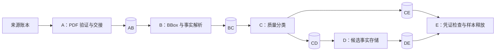

# Prestock · 财报数据处理与质量分析

面向历史行情与企业财报研究的数据基础设施项目。围绕十万量级财报，构建从 PDF 解析、财务事实提取到质量分类与候选存储的处理流程。

项目沿着两条主线推进：**通过并行流水线提高处理吞吐，通过原文核对和质量分析提高数据利用率。**

## 运行演示

使用 Python 3.11+，在本目录安装依赖后运行：

```bash
python -m pip install -r requirements.txt
python demo.py
```

演示使用三份合成 BBox 表格，复用项目的解析器、23 项指标字典和质量分类器，展示“输入 → 财务事实 → 质量结果”的处理过程。

| 样例 | 提取事实 | 本期合并指标 | 分类与原因 |
| --- | ---: | ---: | --- |
| 指标完整 | 46 | 23 | complete |
| 缺经营现金流 | 44 | 22 | invalid：缺少关键锚点 |
| 标题识别异常 | 0 | 0 | invalid：零候选事实 |

结果写入 `demo-output/`，每个样例分别生成 `facts.json` 和 `quality.json`，总览保存在 `summary.json`。

[查看样例说明与结果文件 →](docs/demo.md)

## 迭代过程

### 1. 构建串行原型，跑通处理流程

先搭建串行流程，完成财报处理链路，初期吞吐约 **12–16 份/分钟**。以此为基础，明确各处理环节的输入、输出与交接关系。

### 2. 重构五节点流水线，提高持续吞吐

面向数据规模提出并行化方案，抽象可复用的 `Node` 与 `BufferPool`，将五个处理节点部署为独立进程，各节点内部配置多个 worker，通过独立缓冲池交接任务。

在固定 **2,000 份本地 PDF 临时副本**上，经过 120 秒预热与 30 分钟持续测量，平均终结确认吞吐达到 **59.57 份/分钟**，30 个完整分钟均达到 40 份/分钟的验收目标。

| 阶段 | 结果 |
| --- | --- |
| 串行原型运行 | 约 12–16 份/分钟 |
| 五节点流水线固定样本测试 | 平均 59.57 份/分钟 |
| 完整分钟吞吐范围 | 41–70 份/分钟 |
| 来源进入至终结确认 P95 | 33.79 秒 |

[查看实验配置、逐分钟计数与样本核账 →](docs/performance.md)

### 3. 从筛除异常出发，分析数据质量

检查运行汇报时，发现近期报告的筛除更明显。随后抽取原始 PDF 对比，并使用 Codex 辅助对照原文、解析结果与质量规则，定位两类主要问题：

- **解析入口覆盖**：完整报表标题驱动的入口需要扩展到摘要指标表。
- **质量判断粒度**：报告完整性与单条事实可信度需要分别判断，保留有价值的候选事实及其来源。

围绕提高质量和数据利用率，推动形成摘要指标表独立提取、事实与报告分层管理两项改进方案，并要求使用原有测试集验证。

[查看质量排查过程与改进设计 →](docs/quality-case.md)

## 架构设计



- **节点复用**：五节点共用同一 `Node` 实现，各自配置业务处理逻辑和 worker 数量。
- **缓冲池隔离**：五个 `BufferPool` 各自管理独立 SQLite 数据库，承接相邻节点的任务交接。
- **分类与存储**：C 节点按报告质量分流，D 节点保存达到提交条件的候选事实。
- **任务核账**：分别记录准入、终结、技术失败保留与事实入库数量。

## 个人分工与工具协作

我负责原型构建、并行架构设计、异常发现及改进目标与验证要求的制定，使用 Codex 辅助细化实施计划、编写代码与分析解析结果。

## 项目进度

| 工作 | 当前进度 |
| --- | --- |
| 串行处理原型 | 已跑通，记录初期吞吐 |
| 五节点、多 worker 流水线 | 已实现，完成 30 分钟固定样本吞吐验收 |
| 报告筛除原因分析 | 已完成解析入口、指标识别及分类规则的原因拆解 |
| 摘要提取与质量分层 | 已形成改进方案，进入后续迭代 |
| 可运行展示样例 | 三类合成 BBox 样例已跑通，提供一条演示命令与示例输出 |
| 解析与演示回归 | 35 项测试通过，覆盖列角色、期间、口径、标题与质量分类 |

## 材料导航

- [性能实验与优化过程](docs/performance.md)
- [质量排查案例与改进设计](docs/quality-case.md)
- [机器可读性能摘要](evidence/performance.json)
- [运行演示与样例说明](docs/demo.md)
- [复用源码的版本指纹](evidence/source-manifest.json)
